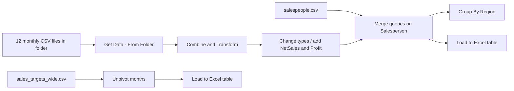

---
lab:
  title: Power Query - Combine monthly sales files into a consolidated report
  module: Module 11 - Power Query
  description: In this lab, you use Power Query in Excel to import a folder of 12 monthly CSV files, clean and transform data, merge with a lookup table, unpivot a target table, group data and load the result to Excel.
  duration: 90 minutes
  level: 300
  islab: true
  primarytopics:
    - Excel
    - Power Query
---

# Combine Monthly Sales Files with Power Query

**Lab Number:** 11
**Lab Title:** Consolidate Monthly Sales Files with Power Query
**Module:** Module 11 – Power Query
**Difficulty Level:** Intermediate to Advanced
**Estimated Time:** 90 minutes
**Prerequisites:** Labs 03, 07 and 10.
**Excel version note:** **Get & Transform (Power Query)** is built into Excel 2016, 2019, 2021 and Microsoft 365 on **Windows** (Data tab > Get Data). Excel 2010 and 2013 need the free Power Query add-in. Excel for Mac has more limited Power Query features.

## Problem Statement

Every month the sales team sends a separate CSV file. Someone copies and pastes 12 files into one sheet and repeats this for every new month. It is slow and error-prone.

## Business Scenario

You must build a **refreshable** consolidated report: drop new monthly files into a folder and click **Refresh**. You also need to add each salesperson's manager and convert a wide target table into an analysis-friendly layout.

## Learning Objectives

- Import data from CSV and from a folder.
- Use the Power Query Editor, Applied Steps and data types.
- Remove columns, filter rows, replace values, split and merge columns, remove duplicates.
- Add custom columns, append and merge queries, group, pivot and unpivot.
- Load results to Excel and refresh.

## Dataset Download

| File | Records | Link |
|---|---|---|
| monthly_sales/sales_2024_01.csv … sales_2024_12.csv | 1,200 rows total | [Folder](../Allfiles/Datasets/monthly_sales/) |
| salespeople.csv | 8 | [Download](../Allfiles/Datasets/salespeople.csv) |
| sales_targets_wide.csv | 8 | [Download](../Allfiles/Datasets/sales_targets_wide.csv) |

Copy the whole **monthly_sales** folder to **C:\ExcelLabs\monthly_sales** (or any folder you choose) and the two other CSV files to **C:\ExcelLabs**.

## Dataset Column Description

| File | Columns |
|---|---|
| monthly_sales | OrderID, OrderDate, Region, Salesperson, Category, Product, Quantity, UnitPrice, UnitCost, DiscountPct |
| salespeople | Salesperson, Manager, Team, JoinYear |
| sales_targets_wide | Salesperson, Jan, Feb, … Dec (monthly target, INR) |

## Workflow diagram



## Step 1 – Import the dataset

### Part A – Single CSV

1. Open a blank workbook, save as **PowerQuery-Lab.xlsx**.
1. Select **Data > Get Data > From File > From Text/CSV**, choose **salespeople.csv**, then select **Load To... > Only Create Connection** (or **Transform Data** to look first).
1. In the Power Query Editor note: the **Queries** pane (left), **Formula Bar**, **Applied Steps** (right) and the preview in the middle.

    

### Part B – From Folder

1. Select **Data > Get Data > From File > From Folder**, browse to **C:\ExcelLabs\monthly_sales** and select **Open**.
1. In the preview select **Combine > Combine & Transform Data**. Choose the sample file (first file) and **OK**.
1. Power Query creates helper queries and a final query named **monthly_sales**. Rename it **Sales**.

## Step 2 – Inspect the data

1. In the **Sales** query, confirm **1,200 rows** in the status bar (bottom left).
1. Turn on profiling: **View > Column quality**, **Column distribution**, **Column profile**.
1. Check that **Source.Name** (new column with each file name) shows 12 distinct values.
1. Check data types in each column header: **OrderDate** should be Date, **Quantity/UnitPrice/UnitCost/DiscountPct** numbers.

## Step 3 – Apply the Excel operation

All steps below appear in **Applied Steps**; click a step to see the data at that point and **delete a step** with the **X** to undo it.

1. **Change types:** select each column and set **Data Type**: OrderDate = **Date**; Quantity = **Whole Number**; UnitPrice, UnitCost = **Decimal Number**; DiscountPct = **Decimal Number**.
1. **Remove columns:** right-click **Source.Name** > **Remove** (or keep it as `SourceFile` after renaming).
1. **Filter rows:** click the **Region** filter arrow, untick any blank or null values.
1. **Remove duplicates:** select **OrderID** > **Home > Remove Rows > Remove Duplicates** (none should be removed).
1. **Replace values:** select **Region** > **Transform > Replace Values**; for practice replace `East` with `East Zone`, then delete that step.
1. **Split column (practice):** select **OrderID** > **Home > Split Column > By Delimiter > Custom `-`**. You get `ORD` and `10001`. Delete the step after reviewing, or keep it on a duplicate query.
1. **Merge columns (practice):** select **Region** and **Salesperson** > **Transform > Merge Columns** > separator `|`. Delete it after.
1. **Add custom column:** **Add Column > Custom Column**, name **NetSales**:

    ```m
    [Quantity] * [UnitPrice] * (1 - [DiscountPct] / 100)
    ```

    Add **Profit**:

    ```m
    [NetSales] - [Quantity] * [UnitCost]
    ```

    Set both to **Decimal Number**.

1. **Add Month name:** select **OrderDate** > **Add Column > Date > Month > Name of Month**.

## Step 4 – Apply formulas

### Merge queries (like a VLOOKUP)

1. Make sure **salespeople** is loaded as a query (Step 1A).
1. Select **Sales** > **Home > Merge Queries**. Choose **Salesperson** in Sales, then the **salespeople** query and its **Salesperson** column. **Join Kind: Left Outer**. **OK**.
1. Click the expand icon on the new column, tick **Manager** and **Team** only, untick **Use original column name as prefix**. **OK**.
1. Check that **Manager** is not null for any row.

### Append queries (stacking)

1. **Home > Append Queries as New > Three or more tables** is for appending; for a practice, open **sales_2024_01.csv** and **sales_2024_02.csv** separately with **From Text/CSV**, then **Append Queries as New** with these two tables. You get **Jan + Feb rows** (78 + 82 = **160** rows).

### Unpivot the target table

1. Import **sales_targets_wide.csv** with **From Text/CSV > Transform Data**; rename the query **Targets**.
1. Select the **Salesperson** column, then **Transform > Unpivot Columns > Unpivot Other Columns**.
1. Rename **Attribute** to **Month** and **Value** to **Target**. Set Target to **Whole Number**.
1. Result: **96 rows** (8 salespeople × 12 months) in **long** format, ready for pivots.

> *Pivot is the opposite: **Transform > Pivot Column** turns values from one column into new columns. Wide format is easy to read; long format is easy to analyse.*

### Group By

1. Duplicate the **Sales** query (right-click > **Duplicate**) and rename it **SalesByRegion**.
1. **Home > Group By**. Advanced: Group by **Region**; add aggregations:
    - **Orders** = Count Rows
    - **TotalNetSales** = Sum of **NetSales**
    - **TotalProfit** = Sum of **Profit**

## Step 5 – Analyse the results

1. Click **Close & Load To...** on **Sales**; choose **Table** in a **New worksheet**. Excel loads **1,200 rows**.
1. Load **Targets** and **SalesByRegion** as tables on separate sheets.
1. Check **SalesByRegion** against Lab 04: South ₹1,92,86,136, West ₹1,71,15,952.50, North ₹1,46,06,054.50, East ₹1,40,88,106.50.

### Test the refresh

1. Open the **monthly_sales** folder in File Explorer, make a copy of **sales_2024_12.csv** and name it **sales_2025_01.csv** (it adds 117 rows).
1. In Excel select **Data > Refresh All**. The **Sales** table now has **1,317** rows without any copy-paste.
1. Delete the extra file and refresh again: back to **1,200**.

## Step 6 – Create visualization

1. Click inside the **Sales** table and select **Insert > PivotTable** with **Month Name** in Rows and **NetSales** in Values.
1. Insert a **PivotChart** (line) so that the monthly trend updates when new files are added.
1. Insert a **column chart** from **SalesByRegion** (TotalNetSales).

    

## Expected Output

| Check | Expected |
|---|---|
| Combined rows | 1,200 |
| Total NetSales | ₹6,50,96,249.50 |
| Total Profit | ₹1,30,79,789.50 |
| Merged Manager column | No nulls (8 salespeople mapped) |
| Targets after unpivot | 96 rows |
| SalesByRegion | 4 rows (orders: North 305, South 314, East 274, West 307) |
| After adding a 13th file | 1,317 rows; back to 1,200 after removal |

## Screenshot of final result


## Business Insights

- Automation turns a monthly 30-minute copy-paste job into a one-click refresh, with no formula or pasting errors.
- Keeping the query steps documented in **Applied Steps** makes the process auditable.
- Unpivoted targets can now be joined with actual sales to compute **achievement %**.

## Practice Questions

1. What is the difference between **Append** and **Merge** queries?
1. Why use **Unpivot Other Columns** instead of unpivoting selected columns?
1. What does **Close & Load To... > Only Create Connection** do?
1. How do you undo a transformation in Power Query?
1. Why does Power Query not need formulas copied down?

<details>
<summary>Answer key</summary>

1. Append stacks rows of tables with similar columns; Merge joins tables side by side on a key.
1. New columns (for example a new month) are automatically included.
1. Keeps the query available for other queries without loading a table.
1. Delete the step in Applied Steps.
1. Each step applies to the entire column automatically.

</details>

## Lab Assignment

Merge **Targets** with monthly actual sales (from **Sales**, grouped by Salesperson and Month name) and compute **Achievement % = Actual / Target** with a custom column. Load to Excel and build a conditional-formatted pivot. Optional: replace the file path with a **parameter** so the folder can change.
